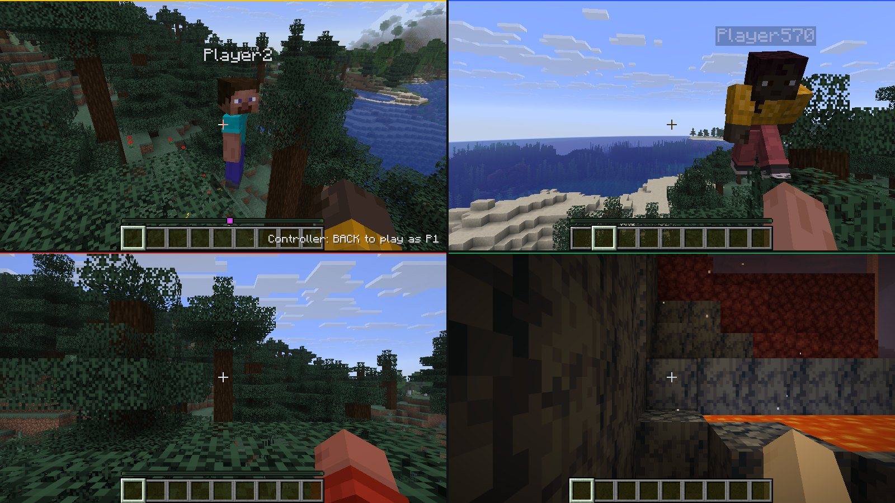
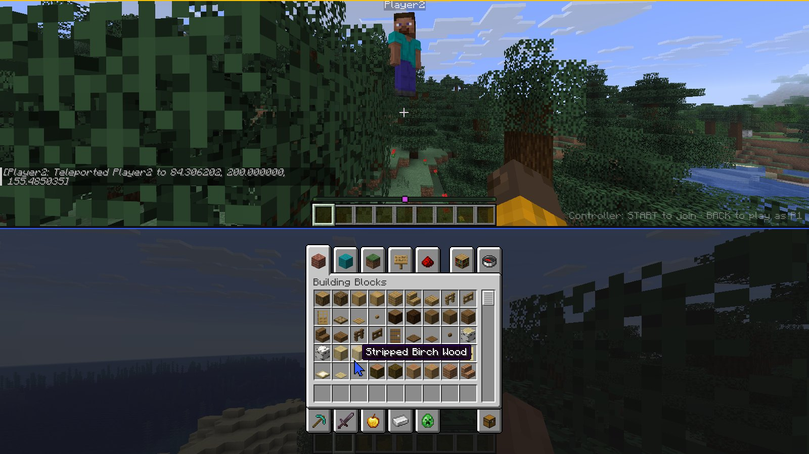
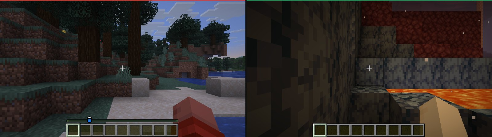
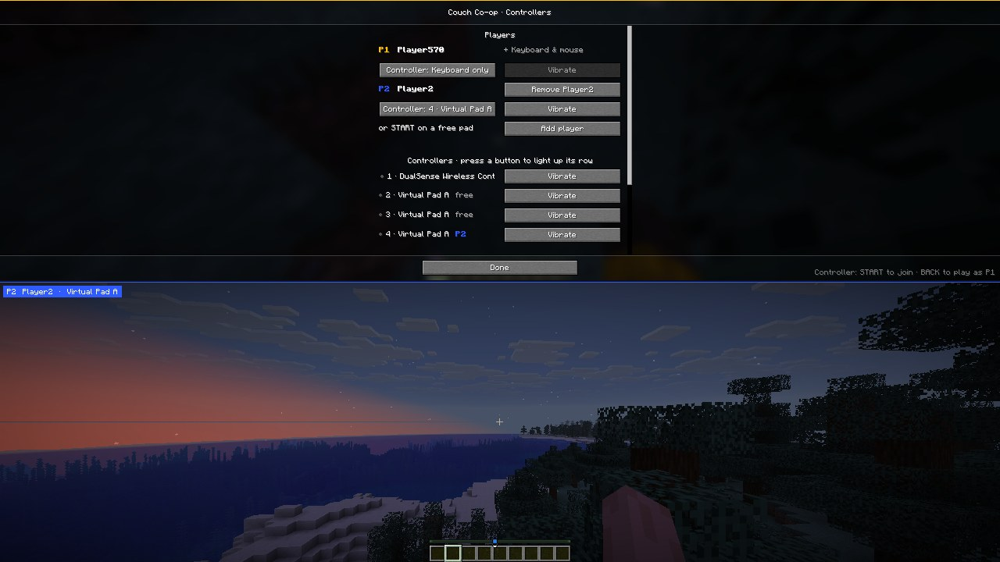

<p align="center">
  
</p>

<h1 align="center">Couchcraft</h1>

<p align="center"><strong>Real split-screen co-op for Minecraft Java. One game, one window, up to four players.</strong></p>

<p align="center">
  <a href="https://github.com/zortos293/Couchcraft/releases/latest">
    
  </a>
  
  <a href="https://fabricmc.net/use/"></a>
  <a href="https://x.com/Zortosdev"></a>
</p>

<p align="center">
  <a href="https://github.com/zortos293/Couchcraft/releases"></a>
  <a href="https://github.com/zortos293/Couchcraft/stargazers"></a>
  <a href="LICENSE"></a>
</p>

<p align="center">
  <a href="#get-couchcraft">Download</a> ·
  <a href="#play">Play</a> ·
  <a href="#inside-the-mod">Features</a> ·
  <a href="#controller-settings">Controllers</a> ·
  <a href="#how-it-works">How it works</a> ·
  <a href="#build-from-source">Build</a>
</p>

<p align="center">
  
</p>

<p align="center"><em>Four players, one Minecraft window. A real in-game capture, not a mockup.</em></p>

I got tired of co-op mods that start a second copy of the game, tile two windows, and fall over the moment
something goes wrong. So I built split screen into the game itself. Couchcraft runs every player inside **one
Minecraft client**: one process, one window, one world. Plug in a controller, press START, and the screen splits,
like the console editions used to.

> [!NOTE]
> There is no second launcher, no second client and no second window. Each extra player is a real player on your
> world's built-in server, with their own camera, HUD, menus, inventory and progress, all inside the same game.

> [!IMPORTANT]
> Couchcraft is a client mod for **Minecraft Java 26.3** on **Fabric Loader**. You don't need Fabric API. Extra
> players can join any singleplayer world, including one you've opened to LAN. They can't join online servers,
> because every player there needs their own Minecraft account.

> [!WARNING]
> This is an early release. It has been tested on the OpenGL renderer with up to four players. It doesn't work with
> Sodium or Iris, and every extra player renders the world again, so lower your render distance if the frame rate drops.

## Get Couchcraft

1. Install [Fabric Loader](https://fabricmc.net/use/) for Minecraft 26.3.
2. Download `couchcraft-<version>.jar` from [Releases](https://github.com/zortos293/Couchcraft/releases/latest).
3. Put it in your `.minecraft/mods` folder and start the game with the Fabric profile.

Any controller that SDL3 recognises works: Xbox, DualSense / DualShock, Switch Pro, 8BitDo and most others.
Minecraft already ships SDL3, so there's nothing extra to install.

## Play

1. Open a singleplayer world.
2. Plug in a controller and press **START**. The screen splits and Player 2 spawns next to you.
3. Do the same for players 3 and 4. Two players stack top and bottom (switchable to side by side); three get a
   wide top view and two below; four get a quad.
4. To leave, hold **BACK + START**. Everyone else keeps playing.

| Action | Controller |
| --- | --- |
| Move / look | Left stick (analog) / right stick |
| Jump · Drop · Pick block · Inventory | A · B · X · Y |
| Attack / Use | RT / LT |
| Hotbar | LB / RB |
| Sprint · Sneak (toggle) | L3 · R3 |
| Pause · Player list | START · BACK |
| Perspective · Swap hands | D-pad ↑ · D-pad ↓ |
| **In menus** | Stick moves a cursor, A click, X shift-click, Y right-click, B back, D-pad nudges one slot |
| **Leave the game** | Hold BACK + START |

**Player 1** can play on keyboard and mouse, a controller, or both at once. Press **BACK** on any free
controller to make it P1's, at any time, also to switch P1 from one controller to another. Keyboard and mouse
never switch off for P1. Only P1 can use them.

| Shortcut | Does |
| --- | --- |
| <kbd>Ctrl</kbd> + <kbd>Shift</kbd> + <kbd>C</kbd> | Open the controller settings (also from the title screen) |
| <kbd>Ctrl</kbd> + <kbd>Shift</kbd> + <kbd>J</kbd> | Add a player without a controller; they can pick one up with START later |
| <kbd>Ctrl</kbd> + <kbd>Shift</kbd> + <kbd>K</kbd> | Remove the last player |
| <kbd>Ctrl</kbd> + <kbd>Shift</kbd> + <kbd>L</kbd> | Switch the two-player layout: stacked ↔ side by side |

## Inside the mod

These are captures from the game running the mod.

### Everyone gets their own menus



Each player has their own inventory, chests, pause menu and death screen, drawn in their part of the screen.
Controller players get a cursor in their own colour.

### Different worlds, same couch



Players don't have to stay together. One of you can be in the Nether while the others build in the Overworld.

### Your profile comes back with you

Every player is a real player on your world. Their inventory, armour, XP, advancements, statistics and spawn point
are saved with the world, the same way as in multiplayer. Each guest name maps to a fixed ID, so when Player 2 joins
your world again next week, they pick up exactly where they left off. Your controller settings and guest names are
saved too.

### House rules

- **Pause is a vote.** The world only freezes when everyone is in a pause menu. One player checking the menu
  doesn't stop the others.
- **Every sound once.** Each player's copy of the world hears the same sounds, so Couchcraft drops the duplicates and
  plays each sound from the nearest player's point of view.
- **Leaving is personal.** When a guest picks *Save and Quit*, gets kicked, or holds BACK + START, only that guest
  leaves. When the host quits, everyone's progress is saved.
- **Guests share the cheats.** If the world has cheats on, guests can use commands too.
- **Controllers count as input.** Minecraft drops to 30 FPS, then 10, when it thinks nobody is playing. Controller
  input now counts as playing, so a couch on controllers never gets throttled.

## Controller settings

Open them from the pause menu (**Couch Co-op…**) or with <kbd>Ctrl</kbd> + <kbd>Shift</kbd> + <kbd>C</kbd>.

<p align="center">
  
</p>

- **Players.** Every player with their colour and what they play with. Pick a controller for any player; if
  another player holds it, the two swap. P1's *Keyboard only* means no controller. Add or remove players here.
- **Controllers.** Every connected controller, numbered, with its owner. A light next to it turns green while you
  press anything on it. **Vibrate** buzzes the controller and blinks its light bar or player LED, so you can tell
  which one is which.
- **Settings.** Look speed, invert look, stick deadzone, menu cursor speed, rumble on damage, the join hint and the
  two-player layout.

Controllers also light up in their player's colour (light bar or player LED), and rumble when that player takes damage.

<details>
<summary><strong>Config file</strong></summary>

`config/couchcraft.json` is created on first launch. The settings screen edits the same values.

| Key | Default | Meaning |
| --- | --- | --- |
| `twoPlayerLayout` | `STACKED` | `STACKED` (P1 on top) or `SIDE_BY_SIDE` |
| `guestNames` | `Player2..4` | Names for players 2–4 |
| `guestsInheritCheats` | `true` | Guests may use commands when the world allows them |
| `lookSpeedYaw` / `lookSpeedPitch` | `280` / `190` | Full-tilt turn speed, degrees per second |
| `invertLookY` | `false` | Invert vertical look |
| `stickDeadzone` | `0.16` | Stick deadzone |
| `cursorSpeed` | `300` | Menu cursor speed, GUI pixels per second |
| `rumble` | `true` | Rumble on damage |
| `showJoinHint` | `true` | "START to join" hint while a controller is free |

</details>

## How it works

Minecraft's client is built around one player: one `player`, one `level`, one `GameRenderer`, one `Gui`.
Couchcraft gives every player a `PlayerContext` that holds their copy of all of those, and swaps it in for the short
moment that player is being ticked, drawn or sent a packet.

- **Network.** Each guest logs into your world's built-in server over its own in-memory connection, the same way
  the host does. The server sees ordinary players, which is why saving, permissions and advancements just work.
- **Ticks.** The game ticks once per player. Music, the sound engine and textures tick once.
- **Rendering.** Minecraft 26.3 renders in update → extract → render phases. Each runs once per player inside a
  *virtual window*: the game is told the window is that player's viewport, so the camera, GUI scale, menus and
  render targets size themselves. The finished frames are copied into one window-sized image with plain GPU copies.
- **Input.** Keyboard and mouse belong to P1, with the mouse remapped into P1's part of the screen. Controllers are
  read through SDL3's gamepad API, which Minecraft already ships, and drive each player's own key bindings, analog
  movement, camera and menu cursor.
- **A fix for vanilla.** 26.3's OpenGL backend passes a width where `glBlitFramebuffer` expects an end coordinate,
  so copying a texture to any spot except the top-left corner fails. Vanilla never does that; the compositor does,
  so Couchcraft corrects the call. Copies at the corner behave exactly as before.

## Build from source

You need JDK 25.

```sh
git clone https://github.com/zortos293/Couchcraft.git
cd Couchcraft
./gradlew build
```

The jar ends up in `build/libs/`. To run a development client:

```sh
./gradlew runClient                  # dev client with the mod
./gradlew runClient -PcouchGuests=1  # adds one guest once you're in a world
./gradlew runClient -PcouchDev=Test  # automated test session (see below)
```

`-PcouchDev=<world>` creates or opens that world, plugs in virtual SDL controllers and plays a scripted session:
joining, walking, looking, menus, two-, three- and four-player layouts, death, the Nether, resizing, leaving, the host
quitting, rejoining, P1 on a controller, switching controllers and the settings screen. It writes captures to
`run/couchcraft-dev/`.

## Known limits

- Extra players can join singleplayer and LAN-host worlds, not online servers.
- Not compatible with Sodium or Iris, which replace the world renderer Couchcraft creates per player.
- Every extra player renders the world again, so four players cost roughly four times the GPU work of one.
- Guests can't type in chat or on signs, because there's only one keyboard.
- In small windows, half-screen views use a smaller GUI scale so the largest menus still fit.

## Contributing

Issues and pull requests are welcome. If something breaks, open an issue with your `latest.log`, your controller
model and how many players were in the game.

## License

[MIT](LICENSE). Couchcraft isn't affiliated with Mojang Studios or Microsoft. Minecraft is a trademark of Mojang
Synergies AB.
